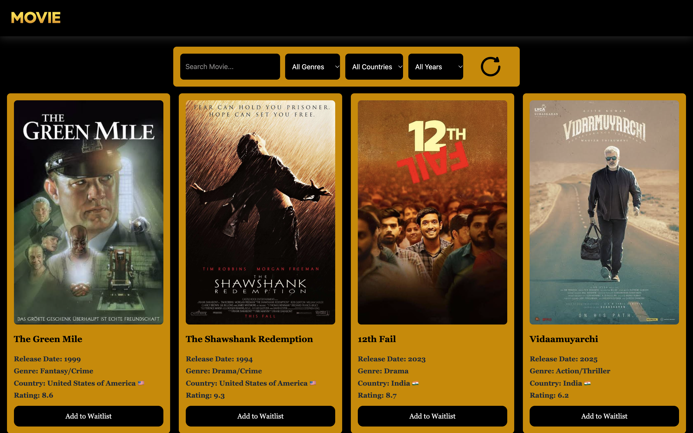
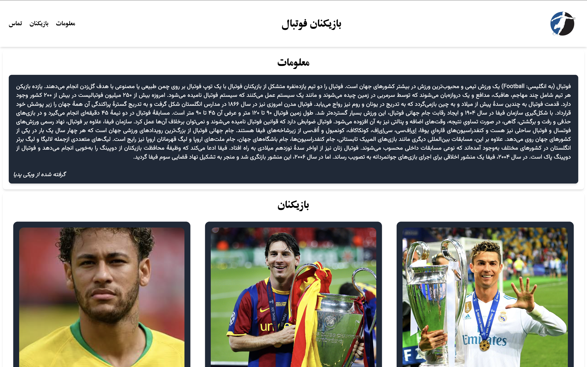

 <div align="center">


# Fardin Mehry | Portfolio

### Frontend Developer & Mobile App Developer

**A modern, responsive personal portfolio built with React and Vite.**

[](https://react.dev/)
[](https://developer.mozilla.org/en-US/docs/Web/JavaScript)
[](https://developer.mozilla.org/en-US/docs/Web/HTML)
[](https://developer.mozilla.org/en-US/docs/Web/CSS)
[](https://vite.dev/)
[](https://vercel.com/)

[](https://github.com/fardinme6/Fardin-Portfolio)
[](https://github.com/fardinme6/Fardin-Portfolio)

</div>

---

## 👋 About This Project

Welcome to my personal portfolio!

I'm **Fardin Mehry**, a Computer Science student, Frontend Developer, and Mobile App Developer.

I created this portfolio to showcase my programming skills, projects, education, and development journey.

The website features a modern dark-blue design with cyan accents, responsive layouts, and interactive elements.

## 🖼️ Portfolio Preview

<div align="center">


**Explore my work, skills, and development journey.**

</div>

## ✨ Features

- 📱 Fully responsive design for desktop, tablet, and mobile
- 🎨 Modern dark-themed user interface
- 👨‍💻 Interactive About Me section
- 🔄 Profile image flip animation
- 💻 Projects showcase with visual previews
- 🎓 Education and learning journey
- 🛠️ Technical skills with progress bars
- ✉️ Contact form
- 🔗 GitHub and social media links
- ⬆️ Back-to-top button and smooth scrolling
- ⚡ Optimized production build using Vite

## 🛠️ Technologies & Tools

<div align="center">


</div>

| Technology | Usage |
|---|---|
| HTML5 | Website structure |
| CSS3 | Responsive layouts, animations, and styling |
| JavaScript | Interactive functionality |
| React | Component-based user interface |
| Vite | Development and production builds |
| Git & GitHub | Version control and repository hosting |
| Vercel | Website deployment |

## 📁 Project Structure

```text
My Portfolio/
│
├── public/
│   ├── skills/
│   ├── android-chrome-192x192.png
│   ├── android-chrome-512x512.png
│   ├── apple-touch-icon.png
│   ├── DarkMode.png
│   ├── favicon-16x16.png
│   ├── favicon-32x32.png
│   ├── favicon.ico
│   ├── FootballPlayers.png
│   ├── Movies.png
│   ├── profile.png
│   ├── profile1.png
│   ├── profile2.png
│   └── site.webmanifest
│
├── src/
│   ├── components/
│   ├── App.jsx
│   ├── main.jsx
│   └── style.css
│
├── .gitignore
├── eslint.config.js
├── index.html
├── package-lock.json
├── package.json
├── README.md
└── vite.config.js
```

## 🚀 Featured Projects

<div align="center">

| Movie Website | Football Players |
|---|---|
|  |  |
| A movie browsing interface built with React. | A football player showcase interface. |

</div>

## ⚙️ Installation & Setup

**1. Clone the repository**

```bash
git clone https://github.com/fardinme6/Fardin-Portfolio.git
```

**2. Open the project directory**

```bash
cd Fardin-Portfolio
```

**3. Install dependencies**

```bash
npm install
```

**4. Start the development server**

```bash
npm run dev
```

**5. Build for production**

```bash
npm run build
```

**6. Preview the production build**

```bash
npm run preview
```

## 📌 Website Sections

| Section | Description |
|---|---|
| 🏠 Home | Introduction and social links |
| 👤 About | Background and personal information |
| 💻 Projects | Featured development projects |
| 🛠️ Skills | Technical skills and progress |
| 🎓 Journey | Education and learning experience |
| 📩 Contact | Contact information and message form |

## 🎯 Future Improvements

- Add more real-world projects
- Improve accessibility
- Enhance animations and interactions
- Optimize image loading and performance
- Continue refining the user experience

## 📬 Connect With Me

<div align="center">

[](https://github.com/fardinme6)
[](mailto:fardinmehry7@gmail.com)

</div>

## 📄 License

Created for personal portfolio and educational purposes.

---

<div align="center">


### Thanks for visiting!

If you like this project, consider giving it a ⭐ on GitHub.

**Designed & Developed by Fardin Mehry**

</div>
